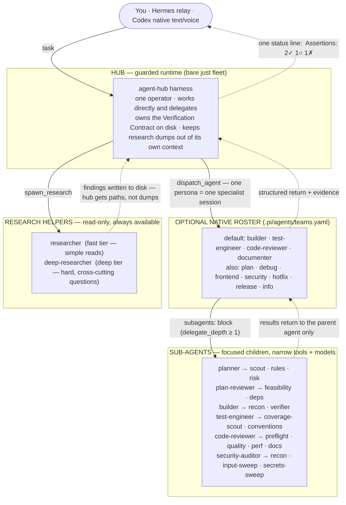
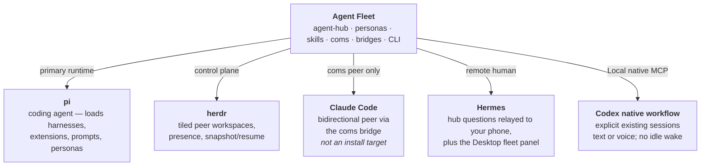

# Agent Fleet Architecture

Agent Fleet is a Pi-centered multi-agent orchestration system. This page maps
the runtime responsibilities and where each module lives in the repository.

For the principles governing future plans and design decisions, read the
[project philosophy](PHILOSOPHY.md). That document states the intended direction;
this page describes the current architecture.

Native chat connection leases, exact-owner receiver control, notification renewal, Fleet View status, and remaining host-bootstrap limits are described in [Codex connections](codex-connections.md). The new workflow does not auto-start delivery or retarget sessions after restart.

## Session worktree root contract

The intended external Fleet layout is:

```text
root/
├── af/                 # Fleet workspace: justfile, .pi/, .ai/, runtime dependencies
├── repo/               # application's main Git checkout; no Fleet installation
├── repo.worktree/      # registered linked/detached application checkout
└── docs/               # separately configured rules/documentation repository
```

Here `workspaceRoot` / `resourceRoot` / `configBase` are `root/af`,
`repositoryRoot` is `root/repo`, and `executionRoot` / `worktreeRoot` are
`root/repo.worktree`. Relative selectors are resolved from `af`, so that checkout
is `../repo.worktree`, not `./repo.worktree`. External docs/rules paths must be
explicitly configured relative to `af` (for example `../docs`); neither sibling
placement nor selecting a checkout grants read, write, or remote-export consent.
Fleet must not be copied or symlinked into the application's checkouts.

`just fleet --worktree <registered-checkout>` binds a session to immutable,
canonical filesystem/Git registry identities independently of HEAD. Configuration,
resources and Fleet evidence remain workspace-owned; a managed symlink install
also pins its separate physical Fleet resource root without moving human config.
Coding tools, Git, native
specialists and workflow data use the execution root. Communications, retention
and resume carry target identity. Serialized transport is revalidated, never a
permission. Scoped workflows do not mutate a global active checkout.

System 1 requires exact, separately approved per-consumer physical-target scopes.
Off, pending consent, invalid adaptation, unchecked provider health and actual
consumer results are distinct. A scout clone cannot borrow source-export consent
from its source checkout. Routing is not OS isolation or external-service
isolation. Targeted `/btw` and Hermes conductor explicitly refuse unsupported
combinations. Interactive Pi history retains its global cwd-scoped location;
Fleet artifacts and native session files remain partitioned in the workspace.

See [usage and boundaries](session-worktree-targeting.md) and the
[implementation/verification plan](plans/2026-0-archive/PLAN-session-worktree-targeting.md).
No target-local Fleet copy or cwd-only workaround is needed.

## Runtime layers

| Layer | Role | Implementation |
| --- | --- | --- |
| **Pi Coding Agent** | Primary local runtime — runs the dispatcher and specialist subagents | `.pi/harnesses/`, `.pi/extensions/`, `.pi/agents/`, `.pi/prompts/` |
| **agent-hub** | Thin-context multi-agent harness: dispatcher + specialists + research helpers + Verification Contract | `.pi/harnesses/agent-hub/` |
| **Workflows** | Headless, code-owned phase order, retries, gates, writes enforcement, and acceptance through `just flow` | `.pi/agent-fleet/scripts/flow.ts`, `.pi/agent-fleet/scripts/workflows/` — see [workflows.md](workflows.md) |
| **Herdr** | Fleet/workspace control plane — spawns peer teams as tiled workspaces, presence via push events, snapshot/resume | [herdr.dev](https://herdr.dev); client in `.pi/harnesses/lib/herdr-client.ts`, layout in `.pi/agent-fleet/scripts/lib/herdr-layout.ts` |
| **coms** | Peer communication protocol/data plane — envelope-based P2P messaging between agents | Shared peer lifecycle in `.pi/harnesses/lib/coms-core.ts` and `coms-core-io.ts`; Pi registrations in `.pi/harnesses/coms/` and `agent-hub/`; wire helpers in `.pi/agent-fleet/scripts/lib/coms-envelope.ts` and `.pi/agent-fleet/scripts/coms-cli.ts` |
| **Fleet config screen** | Read-only in-session view of what is configured and active (`/af-config`, Alt+,) in the Hub and every coms peer; file facts and hash checks locally, installer evaluation through the read-only `agent-fleet inspect` verb (`bin/lib/inspect.js`) via a shell-less CLI bridge, and changes only as confirmed `agent-fleet setup`/`configure` runs after a dry-run preview and a matching second dry run | `.pi/harnesses/lib/fleet-config/` (snapshot, view, transition, ui, cli-bridge, mutations); registrations in `.pi/harnesses/agent-hub/commands/config.ts` and `.pi/harnesses/coms/index.ts` — see [setup guide](agent-fleet-setup.md#viewing-configuration-from-a-live-session) |
| **Claude Code bridge** | Makes an interactive Claude Code pane a bidirectional coms peer | `.pi/agent-fleet/scripts/coms-claude-bridge.ts`, `.pi/agent-fleet/hooks/coms-stop-hook.mjs`, `skills/peer-coms/` — see [claude-code-coms-bridge.md](claude-code-coms-bridge.md) |
| **Hermes bridge** | Remote human control — relays hub questions to Telegram, races phone vs. local answers, conductor/liaison skills | `.pi/agent-fleet/scripts/coms-hermes-bridge.ts`, `.pi/harnesses/ask-user-remote/`, `.pi/agent-fleet/hermes/skills/` — see [coms-hermes-bridge.md](coms-hermes-bridge.md) |
| **Hermes local monitor transport** | Local, authenticated monitor contract for Hub-owned task generations; consumers supply their own presentation | `.pi/harnesses/agent-hub/monitor-*.ts`, `.pi/harnesses/lib/hermes-monitor-{model,store,registry,socket}.ts` (with compatibility re-exports under `.pi/agent-fleet/scripts/lib/`) — see [Hermes artifacts](../.pi/agent-fleet/hermes/README.md#local-agent-hub-monitor-integration) and [watchdog limits](hermes-watchdog-supervisor.md) |
| **Hermes Desktop plugin** (`agent-fleet-herdr`) | Fleet observability surface — read-only panel of every live session joined from the coms registry, herdr presence, agent transcripts, and the monitor transport; `focus` and subagent `cancel` are its only write doors | `.pi/agent-fleet/hermes/desktop-plugins/agent-fleet-herdr/` (Electron pane), `.pi/agent-fleet/hermes/plugins/agent-fleet-herdr/dashboard/` (FastAPI backend), installed by `.pi/agent-fleet/scripts/install-hermes-plugin.sh` — see [hermes-desktop-plugins.md](hermes-desktop-plugins.md) |
| **Native Codex MCP** | Local exact-context, multi-session observations and human-confirmed actions; no daemon or idle wake | `.pi/agent-fleet/scripts/fleet-codex-local-mcp.ts`; user-level registration and the `fleet-native-voice` skill copy through the explicit `agent-fleet set-codex-mcp` command (`bin/lib/set-codex-mcp.js`) — see [setup guide](codex-setup.md), [native guide](codex-local-mcp.md) and [retired CLI migration](codex-session-bridge.md) |
| **System 1 foundation** | Experimental shared structured-judgment service; TypeSafe Jev only, with independent watchdog/dispatch/proactive/task-triage/agenticAsk/fileDiscovery/contextCompaction/damageGuard consumer opt-ins | `.pi/harnesses/lib/system1/`, feature `system1`, human-owned `.ai/system1.json` |
| **System 1 dispatch advice / communication** | Optional off-by-default `dispatch_triage` tool; shared-service memory-only Fleet `1` viewer, independently opt-in; live calibration not yet accepted | `.pi/harnesses/agent-hub/dispatch-triage-*.ts`, `system1-communication-store.ts`, `ui/system1-communication.ts` — [guide](system1-dispatch-triage.md) |
| **System 1 task triage** | Active uncalibrated opt-in: uncertain predicates add process obligations, never spend/permission authority; session Fleet/audit metadata | `.pi/harnesses/agent-hub/task-triage-*.ts`, human-owned `consumers.taskTriage` in `.ai/system1.json` — [config/recovery](agent-fleet-setup.md#task-triage-active-experimental-off-by-default) |
| **System 1 file discovery (D9)** | Off-by-default automatic full-list file ranking; parent scheduler/cache/durable budget, guarded source export, private UDS broker and per-physical-attempt native/descendant identities; no permission or acceptance authority | `.pi/harnesses/agent-hub/file-discovery/`, `tools/ask-system1-files.ts` — [scope/status/full-list and activation](system1-file-discovery.md) |
| **System 1 damage guard (D6)** | Off-by-default independent commands/edits/results scopes over mandatory Damage-Control baseline; parent-owned durable decisions, approval and native capability transport; production wiring exists, acceptance remains open | `.pi/harnesses/agent-hub/damage-guard-*.ts`, `damage-control-continue/system1-*.ts`, `result-screen.ts` — [contract and limits](system1-damage-guard.md) |
| **Skill library** | Lifecycle workflows and quality gates every agent follows | `skills/` (native) + `vendor/agent-skills-upstream/skills/` (vendored) — see [UPSTREAM-SKILLS.md](UPSTREAM-SKILLS.md) |
| **Personas** | Reusable specialist definitions, installed verbatim | `agents/` in the package → `.pi/agents/personas/` in a workspace; `bin/lib/personas.js` |

## Private configuration-only verification

The Hub's explicit `private-config-current-state` mode uses
`private-config-current-state.ts` for bounded canonical notification-config/helper
fingerprints and `private-config-review.ts` for fresh native evidence and
independent-review validation. Pure shape/preview, exact-owner, loaded-catalog
and pinned queue-tuple validators live in
`.pi/harnesses/lib/fleet-notification-validation.ts`; the notification runtime
retains its original exports via compatibility re-exports. This keeps the Hub's
packed runtime import closure inside harnesses without importing script-side
notification activation or persistence code. A catalog parity regression binds
the pure expected tool names and assessment results to the public MCP catalog.
The MCP dispatcher retains its original catalog assessment and narrow dependency
allowlist; no notification runtime dependency is added there. Configuration
bodies are not model artifacts or proof output. `process-obligations.ts` retains a separate private proof, not Git
changed-file attribution or ordinary Git review evidence. It closes only a pure
configuration task's own acceptance/review stages; actual proof/gate use requires
live task/session/declaration, revision/fingerprint, receipt/evidence and
concurrency revalidation. Source obligations exclude private closure. The
composition root supplies live context to assertion proof and process reporting;
missing context fails closed. Old Git modes retain their contracts.

This advances deterministic, evidence-owned completion without a fake Git edit or
a generic waiver. Fixture support is not loaded-runtime/activation evidence;
independent whole-feature review and separate human activation remain outside
this implementation. See [verification contracts and limits](operator-current-state.md#private-configuration-only-current-state-separate-opt-in).

## One Hub runtime, independent axes

Every public Pi launch through `just fleet` loads Fleet Core and the `agent-hub`
harness. Three independent choices shape that runtime:

| Axis | Choices | What it controls |
| --- | --- | --- |
| **Operator** | one | The main agent always keeps the captured `read`/`bash`/`edit`/`write` and approved extension surface plus delegation to every installed agent, `poll_panel`, and available coms/Herdr tools. Whether to delegate is its judgment (PHILOSOPHY, 2026-11-11); the former delegate-only `orchestrator` work mode was removed. |
| **Native roster** | empty or one entry from `.pi/agents/teams.yaml` | Which in-process Pi specialist personas `dispatch_agent` may start. Dispatching an installed agent outside the roster adds it. |
| **Peer topology** | current terminal, Hub-only Herdr workspace, or Hub plus a `.pi/agents/peers.yaml` preset | Which separate, addressable Pi/Claude processes occupy sibling panes. Starting or spawning peers does not change the native roster. |

Bare `just fleet` therefore means the operator, an empty native roster, and
the current terminal; `--agents <roster>` only picks the starting roster.
`--work-mode` is deprecated and ignored with a warning, and `/af-agents-*` changes
only the native roster. Dispatch, research, nested delegation, and Verification
Contract rigor follow the **task tier** (`trivial`/`small`/`feature`/`project`),
not a session execution mode. Dispatch/research counts and active duration are
accounting metrics without turn or task continuation quotas. Planner and plan
review are optional; wide/high-risk work retains independent review and applicable
exact-action authorization without a pre-effect planning gate.

Approval memory is shared across Pi's isolated extension loaders within the
runtime. Semantic decisions remain bound to the accepted task/input revision and
exact path; task/session changes fence late answers. Only an exact-action dialog
that showed the human the command records a delete decision; free-form `ask_user`
answers are never recorded and never answered automatically, because prose cannot
prove which path or polarity the human chose. Remembered confirmation is
not a reusable effect grant: actual irreversible effects still consume their
runtime authorization. Identical concurrent dialogs coalesce, and cancellation
does not become consent.

Successful independent reviews retain role-specific evidence, reviewed file
revision, coverage, requirement declarations and input-artifact hashes in the
process journal. An identical covered review returns the retained evidence without
starting another child. Changed accepted input, source, requirements, task, scope, evidence,
concurrent writes or an explicit `review_reason` require a fresh review; unresolved
questions, blocking findings and rejected reviews cannot supply reusable approval.

The model's context hook projects older successful coordination/inspection bodies
to short references backed by exact local originals. It leaves the session journal,
user/assistant messages, questions, failures, images and latest tool batch intact,
and retains a recent inspection working set. The prompt capsule carries current
sourced requirements and critical conditions without treating recorded status as
fresh proof. Plain continue/resume inputs retain the accepted task; identical
classification declarations avoid new triage, revision hashing and journal writes.
Changed intent still uses the existing task-transition fence.

All Hub-owned slash commands are always registered. Capability packs are resolved automatically from explicit task intent, tier, pending work, and compaction state—there is no activation command. Runtime **readiness** (a coms or Herdr connection) is not model-visible capability: ready-but-unrequested peer/workspace packs remain inactive. Ambiguous fleet, peer, and workspace requests are provisionally visible but require one `ask_user` confirmation before their first side effect; a rejection removes the provisional pack. Task packs persist across follow-ups and reset only through `set_task_tier(new_task: true)`, while mandatory work mode and pending-operation leases remain. The verification pack also exposes `set_task_tier` so direct operators can declare explicit risk/scope through the trusted producer without activating fleet dispatch. This does not clear any obligation or change work mode, roster, permissions, or the setter's existing transition/confirmation gates.

`/af-context` is a standalone, read-only full-screen budget diagnostic; it separates stable prompt cost, volatile state, active schemas, and zero-cost inactive/loaded-excluded inputs. Provider totals and cache read/write fields are authoritative where Pi supplies them; it never fabricates provider usage or combines capacity percentages across Hub, child, and peer planes. `/af-audit` is a separate read-only session audit over existing runtime-owned records: it reports allowlisted T1 recovery categories, T2 result states, T3 protocol failures, and T8 permission correlations while keeping root, child, compaction snapshot, and repeated-record identities distinct. It never copies prompts, model text, tool payloads, environment values, or transcript content, and unavailable evidence stays explicit rather than becoming a zero count. Managed specialists and research children use explicit replacement prompts/context manifests with selected persona, policy, and skill paths instead of inherited global skills/context files. Configured project rule and documentation pointers are rendered into the Hub prompt in both work modes and into native specialist, nested delegate, research, and coms handoffs. Files are read directly; folders are resolved index-first, with recursive rule discovery only when no index exists. The prompt carries pointers and selection instructions rather than bulk-injecting rule bodies, and the Hub ledger attributes that text as `hub/policy/project`. Runtime gates control whether an action can proceed: without coms, Herdr, a visible target, or an active roster, the corresponding command refuses with an actionable message rather than disappearing. `--browser` and `--all-extensions` expand the captured operator surface only when those optional extensions are installed.

T12 diagnostics have been withdrawn by user decision; there is no command, runner, or replacement entry point. Historical results and accounting remain unchanged. `diagnostic-series-budget.ts` retains the shared v2 ledger, stage/per-unit ceilings, conservative input preflight, migration refusal for ambiguous history, ownership locks, and cancellation fences used by benchmark consumers. `diagnostic-probe-extension.ts` is now a side-effect-free compatibility library exposing only provider/API output-cap mapping, its types, and the transport refusal exit constant. It preserves the reviewed 2048 cap and rejects unsupported payload semantics; it does not register an extension or tool. Existing sessions must be reloaded after updating. The installer retires unchanged managed command/runner files; user-modified obsolete files are preserved and reported for manual review, never deleted automatically. Such retained files are not imported by the current Hub.

### Context pressure and recovery

Standing prompt ceilings constrain the repeatable replacement prompt and active schemas; they do not
bound conversation messages or results accumulated inside a long tool loop. The Hub therefore has a
second, runtime pressure guard. It samples provider usage, projects a finalized tool result at
`message_end`, warns and exposes transient compaction support at **60%**, then at **70%** aborts the
pre-model continuation and waits for `agent_settled` before requesting one Pi compaction. This
ordering ensures the result is persisted before summarization and prevents an ordinary provider call
from escaping between pressure detection and recovery. Automatic compaction re-arms when measured
usage falls below 60%, or after the history grows by 10% of the window over the first measurement
after a compaction. At the **80%** ceiling, work stops after a failed recovery or when even the
compacted baseline is at or above the ceiling. A baseline between 70% and 80% only warns, because a
small window then keeps working until growth re-arms compaction.

Recovery is single-flight. High-context startup or concurrent input is retained in memory and
replayed exactly once after success; failure retains it for `/compact` or a larger-context model.
`/af-context` and the status line report phase, usage, thresholds, episode, and last outcome. Session
entries store only numeric/enumerated pressure metadata, never prompts, tool payloads, credentials,
error bodies, or summaries.

A persisted native roster is also metadata, not copied configuration: only its team name is stored
and it is re-resolved against current teams and persona definitions. A stale or absent roster is
reported and the session continues without it. A session saved in the removed orchestrator mode
continues as the operator with a one-time notice; the Hub records the operator so the notice is not
repeated. An explicit `--agent-team` selection retains precedence.

Pi's session JSONL is the authoritative append-only record for rebuilding a session, including
compaction and Hub metadata. Pressure and roster recovery operate through Pi/Hub lifecycle APIs;
they never rewrite prior entries. Operators must not edit, truncate, reorder, or synthesize JSONL to
recover a session.

The project selected by `--project <name>` is the coms namespace for the Hub
and every standing or dynamically spawned peer. The Hub-facing peer spawn API
cannot override it. Native subagents remain children of that Hub and inherit
its repository context; peers are separate processes in their own panes.

At dispatch time, `backend: "auto"` applies
`.pi/agents/dispatch-policy.yaml`; `backend: "native"` bypasses same-name peer
substitution; and `backend: "coms"` requires a visible same-name peer and never
falls back to a native child. `.pi/agents/peers.yaml` owns how a peer runs
(`runner`, persona, model, extensions, and declared `env_file`), not whether a
dispatch uses it.

## Fleet hierarchy

Agent Fleet is layered on purpose. Work flows **down** (delegate); evidence and status flow **up** — as compact structured returns, never raw dumps.



Every specialist session is one persona from [`agents/`](../agents/) (installed to `.pi/agents/personas/`) — *skills* tell each agent **how** to work; *personas* define **who** they are (see [agents.md](agents.md)).

The same idea as a tree:

```text
hub (operator by default; orchestrator when selected)
├── optional native roster (empty by default; example: default)
│   ├── builder            → recon · verifier
│   ├── test-engineer      → coverage-scout · conventions
│   ├── code-reviewer      → preflight · quality · perf · docs
│   └── documenter
├── research helpers (spawn_research, any time)
│   ├── researcher
│   └── deep-researcher
└── optional fleet peers (herdr + coms)
    ├── architect / releaser / web-debugger panes
    ├── Claude Code peer (coms bridge)
    ├── Hermes (phone human · inbound ask_user)
    └── Codex native MCP (compatible local host · existing Pi sessions)
```

Composition rule: **the hub (or a slash command) orchestrates; personas do not invoke other personas as peers.** Specialists may only fan out to their configured **sub-agents**. Research helpers write findings to disk; the hub resumes specialists with paths, not raw dumps.

### Automatic file discovery

The independently consented v2 `consumers.fileDiscovery` consumer intercepts eligible
parent inventory/find/ls/grep results and native research/worker/registered descendant
discoveries before the next model step. Pre-spawn context is prepared after launch
gates and rechecked after awaits. One parent runtime owns bounded scheduling,
durable logical reservations, full-question/current-permission cache identity and
individual waiter cancellation. The parent reads guarded files; native attempts
receive private, revocable broker assignments, never the provider key. Sandbox,
tool/depth/tree caps, task authority and mandatory policy remain unchanged.

All display-permitted candidates retain ranked or explicit unscored rows; >255 is
not a semantic limit. Managed per-page artifacts preserve total/offset/next/hash and
normal orchestrator self-read limits. Discovery/evaluation coverage and complete,
partial, unavailable, cancelled and skipped differ. Exact read/grep evidence is
not replaced. Fleet communication capture is opt-in and memory-only: D9 includes
only hashed owner/attempt, trigger, counts/coverage/elapsed and actual-or-unknown
usage, never source bodies, raw queries, arbitrary paths or tokens. Configuration
changes require a new session. Offline production lifecycle/package tests prove
mechanics, not semantic accuracy or final live activation. See the [D9 guide](system1-file-discovery.md)
for exact triggers, unsupported surfaces, residual limitations and unpublished
source/local-tarball commands.

### Optional semantic damage guard

D6's parent Hub owns the shared service, task/accepted-input revision, durable
hold/denial state and shared approval coordinator. Baseline-allowed bash/write/edit
receive scoped pre-call assessment; only valid severe AND sufficient can hold an
exact action. When D6 is enabled or this task has a persisted hold/denial,
native specialists, research helpers and nested delegates have independent
physical-spawn registration, fresh/revocable assignments (including fallback),
stripped inherited assignments and no child provider credentials. Disabled D6
without a persisted fence skips its broker and registration entirely; ordinary
baseline-protected work does not depend on optional assessment IPC.
This is independent of D9 consent and cannot expand effective tools, admission,
OS isolation, budgets or baseline authority. Research stays read-only with
supported result screening; standalone Damage-Control without trusted assignment
has baseline only, and coms peers have no native D6 registration coverage.

Missing/off/invalid/root-off/unavailable-key means no new D6 inference, not
removal of durable fences. `/af-damage-override [actionId]` only re-arms a matching
human dialog, never executes, retries, clears denial or grants path access.
One-use semantic consent still requires current baseline authority after waiting.
Original→D6→D8 composition keeps frozen non-aliased original evidence separate
from appended visible advice; structured `damageGuard` and `fileDiscovery`
views preserve originals or envelope collisions. Failed capture is a gap and
warning absence never establishes trust. See the [D6 guide](system1-damage-guard.md)
for bounded provenance-checked result sources, exact structured API and deadlines.

Production wiring exists in the current worktree; named F10 no-network checks
record SDK/codemode 1.1.0 on Node v25.2.1, not universal compatibility. In that
SDK, non-structured error rejection exposes the original first block, not coverage
text (the nested outcome retains coverage/error). D6 remains incomplete/unaccepted:
A1–A8, independent review/final testing, F12 packaging and F13 final acceptance
remain open. Documentation and module presence do not close those gates.

### Research search supervision

The shared `spawnPiAgent` seam supervises every `read`/`grep`/`find`/`ls` call from native
research helpers and nested delegate children. The supervisor tracks JSONL `toolCallId` values
independently, with a default 120-second deadline (`recon-search-timeout-s: 1..3600|off` under
`## agent-hub`). It is a per-tool watchdog; the whole-run bound is separate — the task-tier
per-run deadline (`agent-turn-timeout-s`), which terminates a hung run as `turn_timeout`.
On timeout or caller cancellation it owns and terminates the child's process group (SIGTERM,
then SIGKILL after a bounded grace), has a separate settlement timer for missing `close`/pipe
drain, and reports timeout separately from cancellation. Research helpers and nested delegates
are each given safe process-group ownership; delegates forward parent termination so no detached
child is orphaned. Full pattern catalog: [references/orchestration-patterns.md](../references/orchestration-patterns.md).

### Usage accounting and supervision

The hub records dispatches, research, review rounds and active time across turns and
saved tasks (`run-budget.js`). None imposes a continuation quota. Legacy
`max-dispatches-per-turn`, `max-research-per-turn` and `turn-wall-time-s` overrides
are ignored with migration warnings. Usage remains visible with unlimited caps.
Task tiers still select delegation, specialist deadlines, recycling and role policy.
Planner and plan-reviewer are optional at every tier. Wide or high-risk classification
and System 1 additions retain independent review and action authorization, not a
Planner admission requirement. Gaps use research; new decisions use `ask_user` grilling.

The root operator and native specialists use the drift runtime. Repeated identical
calls or consecutive failures trigger a bounded judge; a current stuck/drifting
verdict requests cancellation. Root productive call volume alone never triggers it.
Judges are fenced at turn/input/session boundaries; an unavailable judge cannot
fabricate a stop. Root audit entries distinguish an abort request from a confirmed
physical child stop. This is tool-stream supervision, not a wall-time heartbeat or
visibility into an external coms peer's own tools. `watchdog: auto` arms it by default;
an explicit human `off` setting is respected.

Individual child deadlines and operator cancellation remain effective. Session
recycling at run-count/context thresholds and provider concurrency limits remain
independent resource controls. `agent-turn-timeout-s` and `session-recycle-runs`
can tighten their tier defaults. Active-time accounting excludes human waits.

### Runtime acceptance and recovery

Writable specialist operations (`write`, `edit`, or `bash`) receive the same T2 minimal
acceptance contract at every task tier. The trigger is the actual operation/tool contract and
current assertion ledger, not user-language matching or the model's tier label. Read-only
operations remain lightweight. Language heuristics only expose the fuller verification pack;
they are supplementary and do not decide whether changed work needs evidence. Pending
capability leases survive a new-task transition, while stale task packs and assertion state
reset through the explicit lifecycle path.

The runtime-owned result schema is `agent-fleet.runtime-result/v1`. It records orthogonal
`execution` (`completed | failed | pending`), `changes` (`changed | unchanged | unknown`, with
`certain | uncertain | not_observed` attribution), `verification`
(`passed | failed | missing | stale | unsupported`), and `acceptance`
(`accepted | not_accepted`) dimensions, bound to task identity, before/after revision, command,
integer exit status, and evidence references. A changed result and failed verification can
therefore both be true. Compatibility presentation remains
`not_available | deliverable_failed | needs_verification | accepted` for the Hub and
`accepted | rejected` for flows.

Only native Pi children support trusted runtime checks. The Hub injects the code-owned
`runtime-test-check.ts` observer only when the native persona has `bash`; the observer wraps the
existing bash implementation and preserves the normal damage-control `tool_call` approval and
bash error-event semantics. The parent accepts a check only when producer schema, observed bash
start, exact declared command, task, coverage metadata, exit status, and unchanged inspected
revision agree. This proves exact command execution, not semantic adequacy: even a declared
`true` command can pass, so test quality remains subject to independent or human review.
Coms peers cannot produce trusted checks, and `manual`/`runtime-ui` requirements currently have
no trusted producer; all three paths fail closed as missing or unsupported.

The observer and trusted event-correlation path have an observed compatibility dependency on
`@earendil-works/pi-coding-agent@0.84.2`: they rely on its `createBashToolDefinition`, `tool_result`
hook, `args.path`, and JSON-event passthrough contracts. This records the currently verified API
surface rather than changing or independently pinning the package version; Pi upgrades must
re-verify these integration points.

Native runs also retain a bounded record of actual tool starts/ends by tool-call identity. T3
uses those code-owned events only to correlate a terminal, unfenced pseudo-write claim with the
readback of an explicitly declared deliverable. It never executes tool-shaped text. Fenced
XML/JSON documentation examples are excluded; a real matching write event with failed readback
remains a T2 verification/effect failure rather than being relabelled as a protocol failure.

A mismatch emits `agent-fleet.tool-protocol-diagnostic/v1` with category
`tool_protocol_error`, task-or-controlled-probe origin, effective backend/model/tool
configuration, the claimed effect, matching-event and deliverable facts, `none | partial`
effects, this-run-only conclusion, and evidence references. The T2 runtime-result dimensions
remain unchanged and orthogonal. For a real task, the retained diagnostic artifact is the only
input accepted by the task-generation-bound `establishEffects` recovery port; it records what
already happened so unchanged retries cannot replay partial effects. It does not authorize a
retry by itself and does not turn a task failure into a probe result or a universal model
judgment. The withdrawn T12 runner is not part of this path; historical evidence remains archived.

T5's opt-in `filesystem` tool performs deterministic inventory, byte excerpts, artifact readback, and
local-file-only source snapshots without another model run. It is registered in the Hub and native
children but appears in their effective tool surface only while the inherited complete profile has
`assist.deterministic-tools: true`; stale or forged calls are refused at execution too. Profile and
work-mode changes rebuild the truthful T4 catalog, and compaction reconciles that effective surface.
Excerpt hashes and reads a window, not the whole file into memory. Native specialist, research, and nested-delegate explicit tool caps remain
authoritative: the assist flag cannot append `filesystem` outside a declared cap.
Opaque handles bind canonical paths,
content hashes/fingerprints, and offsets; continuation fails on stale bytes or directory state,
and canonical-root checks reject symlink escape. Snapshot bytes and provenance metadata are
stored separately under the owning current session, marked untrusted, and never interpreted as analysis
or fetched from a network origin. Snapshot destinations are runtime-owned and cannot be supplied by the
caller; this narrow artifact creation path grants no general write or shell authority. Every source
path—including the path resolved from a readback handle—passes through the existing damage-control
`zeroAccessPaths` hook before execution, preserving its exemptions and interactive/headless approval
semantics; a denial occurs before source bytes or snapshot artifacts are created. Handle decoding is
single-sourced in `.pi/harnesses/lib/deterministic-handle-path.ts`, so damage-control retains this guard
when installed with its declared shared-library companion but without agent-hub. Inventory names and
all other operation results are marked untrusted. Because snapshot has a managed artifact side effect,
`filesystem` is not classified as replay-safe for automatic mid-run model fallback.
`assist.deterministic-tools` and `assist.bounded-output` are independent. Enabling
`bounded-output` alone bounds read-only tool results inside native specialists, research helpers,
and nested delegates before the next model continuation, and bounds parent reply transport too;
`deterministic-tools` controls the deterministic filesystem assistance without being a prerequisite
for output bounds. The fixed bounds are 500 inventory entries per page, 64 KiB per content/reply,
and 180 Unicode characters per preview; truncation always names a retained full-output path and
retrieval handle. With `bounded-output` off, legacy transport is preserved regardless of the
`deterministic-tools` setting. Inventory records an escaping or unavailable symlink as a denied
entry without traversing it or disclosing its target outside the authorized inventory.
T5 does not consume `assist.write-isolation`; the separate T6c native launch boundary does.
`assist.return-extraction` is opt-in help for models that forget `submit_result`: a native
specialist with tracked assertions that never submits gets the cheap read-only extraction pass
over its written report. The recovered block is labelled extracted, `resultProtocol` stays
`submission_missing`, and acceptance still depends on runtime evidence.

Invocation preflight for `dispatch_agent` and `spawn_research` validates the original
shape before normalization. Invalid input reports bounded safe field locations and
expected/actual types or reasons (`invalid_invocation_shape`), without raw values or
private payloads; unsafe unknown-key locations are redacted. This is distinct from
`invocation_persistence_failed`, where valid input could not be durably retained.
Both refuse before executor launch; persistence refusal releases the in-memory
reservation even when storage cannot retain failure evidence. Correct the named input
or storage prerequisite and re-invoke explicitly under unchanged gates and budgets.

Recovery remains the single T1 contract: no automatic retry, queue, model fallback, or new
numeric allowance. Busy work is refused before execution accounting or history mutation and is
not recorded as no-progress failure. Runtime-owned preflight refusals (`not_started`,
`started:false`, `effects:none`) never launched a process and never become indeterminate
attempts: correcting the input/prerequisite (tier, scope, artifacts, catalog, process) and
re-invoking explicitly proceeds without slash reset, grant, or reconcile, with 0 physical
launches and 0 indeterminate attempts. Refusals use separate accounting and never consume
turn/task launch counters; the anti-loop boundary stays in the guard (unchanged fingerprint
stays refused) while budgets still fail closed on real launches. A settled indeterminate failure permits at most one
explicit, warned, human-authorized retry per logical operation after the prior process is
confirmed finished and the executor is idle; partial side effects may be duplicated. Neither
`/af-recover retry <operationId> <attemptId>` nor legacy `/af-retry <dispatchId>` executes work:
both use the same authorization lane and offer a stored original-contract invocation for a
separate explicit tool call under unchanged budgets and safety gates. Pending/unknown process,
second grant, stale IDs, and missing/invalid/abandoned contracts each fail closed with their
own reason and next actions (independent inspection stays allowed; replay without a validated
contract does not). `/af-recover inspect` is
read-only and reports `not_started` history as needing no slash reset; `reconcile` clears only a technical block when independent current-revision
readback and nonblocking reviewer evidence cover the failed attempt, leaving the immutable
failure and open T2/T11 requirements intact; `abandon` never satisfies dependent work.
Wrapper and evidence producers share one canonical executor identity
(`canonical([cwd, actor])`), so production reconcile matches; task-scoped logical identity is
separate from the persistent effect fence (phantom `not_started` from another task is never
inherited, while cancel/unknown-write/indeterminate fences survive task/model/scope changes).
Launch/close/termination facts travel separately from exit/acceptance: safety refusal and
spawn failure never launched, timeout without close stays uncertain, and integer exit alone
never proves settlement. Unknown shell/backend stays a potential effect with no regex
exemption; the usable inspection route is the effective catalog's read/grep/find/ls (or the
opt-in filesystem tool) with an explicit target path. Tool availability is never gate
admission. Legacy preflight history is freed only with positive runtime-owned no-launch
evidence, never by missing records; unsupported schemas refuse effects without state deletion.
Operator cancellation fences the same agent identity until a fresh, one-use authorization is consumed.
Other agent identities—including the anonymous, read-only research actor—remain independent,
and a task reset does not erase the cancellation fence. Native session reuse is bound to an exact,
normalized current-task contract (task identity, instructions, scope, deliverables, input artifacts,
effective model, and permissions). A different/narrower task starts with a fresh session and
replacement manifest; only an exact continuation, including the auto-research continuation path,
receives Pi resume transport. This remains context hygiene rather than confinement.

When `assist.write-isolation` is explicitly true, dispatch snapshots that effective setting before
routing and forces a native child. Explicit coms is refused because remote isolation cannot be
claimed. The complete Pi process and descendants run under Linux bubblewrap or macOS Seatbelt;
the repository/root view is read-only except for existing exact relative files, expressly allowed
existing recursive directories, and separate current-run runtime/artifact/temp roots. Glob scope,
absolute/escaping scope, symlinked grants, an empty writable grant set, absent or wrong-platform
backends, and sandbox launch failure all fail closed without an unsandboxed retry. Damage-control remains the policy/audit/
approval overlay, but an approval cannot widen the OS boundary already created for a run; a wider
path requires a new explicitly authorized dispatch contract. Network, model, and read access are
otherwise unchanged. Turning the profile flag off does not dismantle an
active process boundary; the next run takes a new snapshot. Opt-out retains the legacy spawn path.
The sandbox never rolls back or deletes user edits, and it cannot protect an allowlisted file from
a concurrent writer. Exact-file grants support direct writes to the existing inode but intentionally
block temp-file-plus-rename atomic saves; callers must explicitly grant the containing directory for
that behavior, and the runtime never widens the grant automatically. Sandboxed spawn uses exactly
three pipe stdio entries and rejects extra inherited descriptors, closing the known writable-FD
bypass. Linux deliberately preserves the Hub-owned process group instead of adding a PID namespace,
and `/dev/tty` remains narrowly available; confinement therefore assumes host ptrace and terminal
injection controls prevent same-uid cross-process escape (for example Linux Yama ptrace restrictions
and disabled legacy TIOCSTI). Linux enforcement is exercised on a real bubblewrap host. Seatbelt
canonicalizes only trusted runtime/artifact/temp aliases such as `/tmp` → `/private/tmp`, while user
scope grants retain strict symlink rejection; its only device write exceptions are literal
`/dev/null` and `/dev/tty`, never a blanket `/dev` grant. The Seatbelt profile has contract coverage
but still requires a Darwin runtime check before T6c is fully verified.

T4 adds a code-owned effective-tool catalog without creating another recovery policy. Every
application of work-mode tools compares the actual active catalog before and after
`setActiveTools` and can emit `agent-fleet.tool-catalog-delta/v1`: removed, added/available,
active substitutes with explicit limitations, `permissionExpansion: false`, and SHA-256 catalog
identities. The delta is persisted as a trusted session entry and included in the next system
prompt. A substitute is only
an already-active path such as `dispatch_agent` or read-only inspection, and is never invoked by
the catalog machinery.

The runtime latches the effective catalog at `before_agent_start`. Actual assistant tool-call
blocks are compared to that originating-turn catalog on the real `message_end` path, so a
next-turn mode switch cannot charge an unknown-tool refusal for a call that was legal when the
turn began; text blocks are ignored and no pseudo-tool text is executed. On `session_compact`,
the runtime reconciles the restored `agent-fleet.tool-catalog-state/v1` identity with Pi's current
active tools, persists restore evidence, and retains the task-scoped unknown-tool counter. Catalog
errors are recorded fail-closed but cannot skip the existing compaction settlement/deferred-input
lifecycle.

Each unavailable tool refusal is keyed by normalized task and tool, while normalized arguments
and catalog identity record whether the request or availability was reevaluated. The
operator-approved limit is exactly three counted refusals, including the first. Mode switches,
compaction, prose, and real catalog changes never refill it; only the explicit new-task lifecycle
resets it. A real `unknown_tool` dispatch failure is stamped by the Hub with the latched,
code-owned catalog identity; a result-supplied identity is ignored. A later successfully persisted
effective-catalog event can establish `toolStateChanged` evidence for the existing T1
`unknown_tool` `recoveryDecision`, but still requires explicit reinvocation and existing general
budgets; it never schedules an automatic retry.

Qualitative guardrails remain separate from usage accounting. **Task triage** classifies
the current task (`trivial`/`small`/`feature`/`project`) for delegation, role and
individual-process resource policy. It survives follow-ups; lowering is free and
raising needs a recorded reason. Skipped triage assumes small. Near-identical
dispatches retain the duplicate guard. Architect, security-auditor and deep-researcher
retain the trivial/small persona gate; Planner and plan-reviewer are optional at
every tier. Review rounds are uncapped. Review findings retain their advisory
budget and source-invariant rule; findings are never silently demoted by position.
**Process obligations (T11)** are task-scoped and independent of that budget tier. The
`set_task_tier` tool accepts explicit `risk` (`unknown | low | high`) and process `scope`
(`read-only | small | wide`); neither is inferred from task prose. Legacy/omitted risk is
`unknown`, risk changes require a reason, and scope expansion requires a reason plus an
explicit risk reassessment. Unknown permits read-only research but cannot accept changed
work. Confirmed low-risk small work uses the existing T2 minimal acceptance path; high risk
adds a separate review stage; wide work also requires independent review. Planning
is optional and never a pre-effect gate. Current stage evidence names an artifact
and revision, without claiming that a model review is semantically adequate. A
requested Planner still needs genuine declared artifact readback to record plan
occurrence. Missing optional planning cannot block an authorized builder, direct
operator or coms peer. Exact-action authorization, independent review, current
verification and task-transition fencing still govern their respective effects.
Exit 0, prompt echoes, pending transport and stale evidence cannot replace them.

Sensitive-work prohibitions remain distinct from positive requests in handoff
advice; neither positive nor ambiguous wording mandates a Planner. Resolve factual
gaps with focused research and additional decisions with `ask_user` grilling.

Dispatch observation preserves the existing snapshot when the session cwd is a Git
worktree. For a non-Git parent it resolves only the literal anchors of declared scopes to
their nearest nested Git roots, rejects roots outside the workspace, and runs path-bounded
status there without recursive discovery or file-content capture. Each repository retains
its HEAD and file metadata separately. Deltas and compiler diagnostics are reported with
workspace-relative paths; compiler discovery runs at the owning repository. Missing roots
and changed HEADs create scope-specific gaps while other roots remain observable. Partial
observation or unavailable compiler coverage cannot establish acceptance through a passing
sibling repository. Runtime session outputs are excluded from nested observation. These
are local source guarantees, not evidence that an installed workspace copy was upgraded.

The same code-owned state is consumed by dispatch acceptance in operator and orchestrator
modes, appended as `agent-hub-process-state`, restored from the session log, and retained
through compaction and mode changes. Only `set_task_tier(new_task: true)` creates fresh
unknown-risk process state. `/af-audit` exports allowlisted satisfied/open/unsupported
obligation statuses and explains that the budget tier limits spend rather than correctness;
reasons and task prose are not copied. This extends the existing task/acceptance/audit paths
and is not a second workflow engine.

**Docs lane** (`docs-lane.js`): a dispatch whose whole declared `scope` is documentation
refuses review personas (overridable with `review_reason`) and tells the dispatcher not to
open a review gate; an absent scope is never the lighter lane. **External-blocker stop**
(`external-blocker.js`): a specialist emits `EXTERNAL_BLOCKED: …` when it needs something
outside the fleet's reach (account, permission, credential, telemetry destination), and the
hub refuses the next dispatch with an owner-escalation packet until the human is addressed —
the alternative, observed, is hours spent approximating the missing fact with scripts,
manifests and fixtures while the assertion still ends UNPROVEN. **Drift watchdog**
(`drift-watchdog.js`): armed dispatches are
observed in-flight from the JSON event stream — deterministic rules (out-of-scope writes
against the declared `scope` globs, tool-call loops, consecutive failures, tool-call cap)
escalate to a one-shot cheap LLM judge whose DRIFTING/STUCK verdict terminates the run as
`drift_stop` (exit 125, partial output preserved); enabled per hub/agent/dispatch
(`watchdog` key, `/af-watchdog`, `watchdog` param); a dispatch `watchdog` param wins over the
per-agent and hub settings. Hub or per-agent `off` remains the opt-out. Two rules about scope: the session's
own `artifacts/`, `findings/`, and `delegations/` subtrees are implicitly in scope (the
deliverable protocol *orders* specialists to write there, and the judge is told so), and the
`scope` rule is non-terminal — it reports a drift advisory on the result and never stops a
run by itself, matching the post-run scope gate, which reverts nothing. **Dynamic teams**: `/af-agents-add`,
`/af-agents-drop`, `/af-agents-save` restructure the roster live (the system prompt rebuilds
every turn), and the gated `team_adjust` tool lets the dispatcher itself adjust the roster
when nested delegation is on (feature/project), with user notification. `/af-hub-report` accounts each turn's dispatches,
tokens (billed = input + cacheRead + cacheWrite), recycles, drift stops, and refusals.

## Runtime stack (tools the fleet sits on)



### Explicit operator current-state verification

`dispatch_agent.review_mode="operator-current-state"` is an explicit native-only verification contract for current Git-visible scoped files, not reconstructed edit authorship. It snapshots the current task/revision, requires complete independent same-state review plus fresh runtime checks for every active automated assertion and AF-MIN-CHANGE, and preserves default changed-task/review/cancellation/action-confirmation gates. Process path/origin distinguishes current-state acceptance; read-only child `changes=unchanged`/`taskAccepted=false` and unsupported manual assertions are not rewritten. Scope mutation, stale input/revision, missing checks or concurrent writers fail closed. No automatic reload, grants, historical records or ledger proof is added. See [contract and manual activation](operator-current-state.md).

### Local Codex observation boundary (experimental)

The STDIO MCP adapter, registered at the user level by `agent-fleet set-codex-mcp` ([setup guide](codex-setup.md)) or through a manual project-local table, uses validated per-call host conversation context and an exact Fleet epoch allowlist (D2-L: cooperative same-user routing, not cryptographic authority). Discovery/read checks are registry-only; `fleet_observe` authorizes before and after one bounded local snapshot. `fleet_overview` aggregates 1–4 explicit selectors with target-local errors and summary-only question previews. Observations never send prompts or answers. Separate instruction/answer prepare/commit/receipt tools require current rights. An explicit user send in the native chat to one unambiguous, already selected current session with read+send authorizes faithful relay without a second confirmation; the client still checks the prepared payload and commits once. Ambiguity requires clarification, changed sessions stop dispatch, and model-initiated or substantively expanded instructions require fresh preview confirmation. This cooperative client interpretation is not server-attested human consent and does not relax binding/grant, question-answer, host approval or receiver execution safeguards. Unknown/partial data and non-atomic snapshots remain explicit; neither registry presence nor a turn boundary establishes task completion. There is no CLI transport fallback, external listener or implicit binding grant. The separately opt-in experimental Desktop queue adapter has limited externally smoke-tested wake evidence, not a general delivery guarantee. Question notifications share a canonical lossless reference codec across ingress, packet and reply; legacy-safe references remain stable, while opaque IDs use a versioned encoding with a derived finite wire bound. The native ID contract, authorization and replay/deadline checks are unchanged. See the [native contract](codex-local-mcp.md).

S5c adds observation-only durable metadata in a separate private `<policyRoot>.observations` namespace, keyed by validated conversation and exact target epoch; it does not alter the allowlist schema or import legacy CLI authority. Stable opaque event/window identities extend the bounded receiver projection. Typed `fleet_resync` and active `fleet_watch` declare local writes (`readOnlyHint=false`), preserve pre/post authorization, and report independent gaps/reset/unsupported continuity and pending/resolved question observations. Cursors are not permission or human-delivery receipts. Watch is bounded by duration, frames, output and concurrency; it does not create background jobs/model wake or cancel Pi work. Source/local verification is not native receiver/MCP activation; any lifecycle/epoch changes remain human-controlled and separate.

### External dependencies

These are the external systems Agent Fleet assumes or integrates with — not npm packages, but the **runtime stack** the fleet operates on top of.

| Dependency | Role | Required? |
| --- | --- | --- |
| **[pi](https://github.com/badlogic/pi-mono)** (or your pi install) | Primary coding-agent runtime; loads harnesses, extensions, prompts, and personas | Yes for `just fleet` |
| **[herdr](https://herdr.dev)** | Workspace control plane: Hub/peer panes, presence push events, team snapshot/resume | Required for `--herdr` or `--peers`; optional for bare `just fleet` |
| **[Claude Code](https://docs.anthropic.com/en/docs/claude-code)** | First-class coms peer via the [coms bridge](claude-code-coms-bridge.md) — cross-model review and analysis. Never an install target: it hosts no skills, commands, or personas | Optional peer |
| **Hermes** | Remote human-in-the-loop (Telegram relay for hub questions — [coms-hermes-bridge](coms-hermes-bridge.md)) and the Desktop fleet panel ([hermes-desktop-plugins](hermes-desktop-plugins.md), needs v0.19.0+ and the Desktop app) | Optional |
| **Compatible Codex host** | Local native MCP with real per-call UUID context, Node 22.18+ and existing COMS sessions — [guide](codex-local-mcp.md) | Explicit local configuration; CLI-only hosts retired, no mobile/remote promise |
| **[addyosmani/agent-skills](https://github.com/addyosmani/agent-skills)** | Upstream skill library (manually vendored) | Bundled (vendored) |
| **[disler/pi-vs-claude-code](https://github.com/disler/pi-vs-claude-code)** | Source inspiration / MIT port origin for pi harnesses | Design lineage (ported in-repo) |
| **LLM providers** | Models per persona (`model:` / `models:` in agent frontmatter) — e.g. OpenAI Codex, GitHub Copilot, Ollama, … | Yes (at least one provider your agents can call) |
| **Chrome DevTools MCP** / **Playwright Agent CLI** | Browser verify (`browser-testing-with-devtools`) and headless automation (`bowser`) | Optional, feature-specific |
| **Node.js + npm** | CLI (`npx @chankov/agent-fleet`), package install, `just` recipes | Yes for install & tooling |

The existing `agent-fleet doctor` command also performs a read-only manifest preflight. It reports exact selected installation files and manifest-declared tool probes as environment readiness, distinguishes missing installation from unknown or unavailable platforms, and names the existing explicit remediation path. Bare doctor never repairs or installs; `doctor --fix` remains the only repair activation, and package/tool installation remains behind its existing explicit consent path.

### System 1 watchdog consumer (off by default)

The native specialist Layer 1 drift watchdog can use the shared System 1 runtime
only after explicit `watchdog-system1: shadow|active` in `## agent-hub`, feature selection,
valid provider configuration, an available key and an armed watchdog. It takes a
session snapshot; setup and doctor do not infer. Shadow starts the LLM judge at
once and separately observes the same bounded state with Jev. Only the LLM
verdict may terminate a child; an unavailable LLM judge is recorded as
`judge_unavailable` and gets one revalidated retry at 5 s, not a successful
90 s cooldown. Successful decisions keep 90 s. Every physical attempt has
separate identities; D1 retries create a new snapshot and do not reuse or
repeat the previous System 1 evaluation.

The state carries a redacted task, relative scope/paths, up to 40 structured
kinds/outcomes/repeat counts, rule facts and coverage, not raw arguments,
commands, edit bodies or outputs. This limit applies to System 1 only: the
existing parallel LLM judge prompt contains the original task, scope and a
recent trail with up to 120 characters of raw tool arguments per call. Use
only reviewed nonsecret pilot inputs; manual review does not rule out
unexpected agent actions. The native spawn boundary removes
`TYPESAFE_API_KEY` after env overrides. This cannot prevent file reads or
requests from other launchers. The append-only session watchdog trace stores
only safe metadata, with explicit unknown usage and interrupted readback.
The below-chat Fleet strip and `/af-agents` owner detail share a projection;
`/af-watchdog` shows readiness/active blocking, `/af-hub-report` separates
watchdog checks, S1 evaluations and LLM attempts, and `/af-audit` lists safe
read-only lifecycle outcomes. UI/trace failure does not change judgment.

`watchdog-system1: active` explicitly opts into an **uncalibrated experimental**
shortcut available in installed workspaces: only advisory `scope` may skip LLM
when Jev `jev-1.13.0` reports provider on-track with confidence and on-track
distribution ≥0.95 and all three contradiction probabilities ≤0.05. Terminal
rules always use the LLM; System 1 cannot stop a child. The watchdog status
labels the mode `experimental: scope only; G2 not validated`; default remains
off and production approved profiles remain empty. Human snapshot labels,
session-separated held-out measurement and independent maintainer G2 approval
are still required before calling this calibrated or expanding its authority. Offline tests and installed-package checks do not
constitute a live pilot (G1) or active approval (G2). Roll back with
`watchdog-system1: off` and restart Hub; cancel the current run if needed.

### Proactive turn review (separate opt-in consumer)

The Hub's `proactive-*` modules compose a separate, off-by-default consumer of the
existing shared System 1 library and its provider/key; they do not create another
provider owner or change watchdog authority. A human-owned per-repository
`consumers.proactiveReview` in `.ai/system1.json` selects `off`, `shadow`, or `advisory` and exact
repository-relative include scope. Missing/off means **zero proactive capture,
inference, and feedback**. Enabled config with `remoteContext: "disabled"` is
local-only: bounded source/rule capture and reviewed local validators may run,
but no semantic provider assessment. `selected-excerpts` separately permits
bounded selected source/assistant excerpts to the shared System 1 service when
it is ready; shadow records findings without delivery, advisory may deliver
feedback at the next *already-occurring* context hook for the same owner,
attempt, task, and bound rule/source revision. It never creates a turn, fixes
code, terminates work, changes acceptance gates, or suppresses the watchdog.
No activation, outbound transmission, or remote repository authorization is
conferred by installing this code or reading this documentation.

At `turn_start`/`turn_end`, Hub and supported native Pi specialists bind the
explicit task/plan and session rule catalog, collect bounded immutable
before/after worktree and text evidence, and retain private snapshots separately
from metadata-only finding/report projections. Source-backed rules come from
`rules:` folders in `## agent-hub` (legacy `## agent-team`), with index-first
Markdown discovery, explicit linked sections, and bounded fallback; discovery
is read-only and never executes rule instructions. Rule identity includes path,
heading occurrence and hash. Incomplete discovery, unselected sections,
unsupported Markdown, missing plan (`task_only`), concurrent edits, and
changed source stays partial, unsupported, uncertain or stale—not
confirmed passes. Rule references use the session-bound revision: on-disk rule
edits do not themselves stale a finding, and a restart is required to adopt them. Only explicitly reviewed bindings support deterministic
local link-form and new-file-placement checks; model findings remain
suspicions, not validated bugs. Rules are **bound per session**: editing a rule
in a running session does not reload it; restart to adopt edits. Research
helpers, nested delegates, coms peers and Hermes are not instrumented by this
consumer. Native observer hooks/integration were checked with repo-local Pi
0.84.2; Node 18 compatibility concerns the extracted installer CLI/doctor,
not running the TypeScript observer under Node 18.

Limits and exclusions, exact config, local report/labels usage, and consent
sequence are in [Project Files — Proactive turn review](agent-fleet-setup.md#proactive-turn-review-experimental).
Offline/installed tests and C5 operator visibility establish neither live-pilot
utility nor universal correctness. The finding-label source fix passed final independent source/docs review;
this establishes offline/package readiness, not human-labelled semantic acceptance. Only retained finding keys
are exposed for human labels: checked-clear units lack an operator-accessible
key, so miss/true-negative labeling and full recall evaluation are not operational.
C7 human acceptance and any release/deployment remain separate. Current caveats include
unknown native delivery without a receipt and a rare async-close error risk.

### Experimental System 1 foundation

System 1 is a shared Fleet library for bounded structured judgments, not a Pi
model and not a workflow stage. Its provider-neutral contract exposes
`choice`, `predicate`, and `ordinal` questions with explicit `ok`, `skipped`,
`unavailable`, `unsupported`, and `cancelled` outcomes. A valid judgment never
grants action authority. The contract retains distributions, predicate
probabilities, and provider confidence when supplied and required, but never
invents missing uncertainty or treats provider confidence as universal
calibration.

The shared service requires saved desired selection of experimental `system1`,
directly or via its `system1-task-triage` feature dependency; automatic Full
excludes both. Use `--save-desired` for permanent CLI changes over an existing
human-owned `.ai/agent-fleet.json`. Provider configuration is a
separate human-owned `.ai/system1.json` with exactly this version-1 contract:

```json
{
  "version": 2,
  "mode": "auto",
  "provider": "typesafe",
  "model": "jev-1.13.0",
  "apiKeyEnv": "TYPESAFE_API_KEY",
  "consumers": {}
}
```

Selection, valid `mode: "auto"` configuration, and a nonempty key in the
caller's environment are all required. `mode: "off"` wins, and key presence by
itself never activates the service. The runtime and imports do not load `.env`
or mutate global environment. Managed `just` launches may load the workspace
root `.env`; direct Node launches must export or inject the key themselves.

The only phase-0 production adapter uses the fixed official TypeSafe endpoint
and pinned `jev-1.13.0` model. It has a 2,000 ms total deadline, including body
collection and at most one budget-fitting retry for 429/529, rejects redirects,
and bounds request and response bodies at 1 MiB without truncation. Cancellation
prevents retry and late-result use; a 401 latches that service instance. Normal
failures return structured, sanitized outcomes rather than raw response bodies.
There is no arbitrary endpoint, SDK dependency, Pi/local-model fallback, daemon,
or local-model installation.

Doctor reuses the shared configuration validator and is advisory, read-only,
and offline—even with `--fix`. It does not inspect or load `.env`; key presence
in its current process remains local readiness, never API validity. The standalone
demo is also offline by default; only explicit `--live` sends its embedded
synthetic Bulgarian/English examples. Public setup and commands are documented
in [Install and lifecycle](npm-install.md#experimental-system-1-foundation).

Consumers own their field allowlists, data consent and policy separately. The
native managed child spawn filters the shared key, but this is not universal
file/environment isolation for arbitrary launchers. Watchdog's active scope
shortcut, profile-gated dispatch advice and active uncalibrated task triage are
different contracts; one consumer's profile/consent cannot enable another.

Evidence stays split: Node 18 verifies installer/doctor portability, real-Pi
synthetic sessions verify registered runtime hooks, and an extracted tarball
verifies install/import closure and disable/resume gates. Human UI observation
and independent checkpoint reviews are separate. None proves live Jev accuracy,
calibration, semantic assertion adequacy or universal remote effects.

### Task triage: additive process evidence, not spend authority

The separately consented `system1-task-triage` consumer evaluates accepted user
input before the first Hub model turn, using the existing shared service even
with watchdog off. It supplies bounded user text and declared scope, not file
bodies, environment, transcripts or tool output. Runtime limits are 40 KiB
aggregate task/clarifications, 64 KiB serialized state, 100 logical evaluations
per saved session and a 2,000 ms deadline including adapter retries. Cache keys
bind input/scope/version; task adoption and compaction/resume cannot refill the
allowance. Physical attempts and unknown usage remain distinct from logical calls.

Independent intent-aware predicates at inclusive thresholds add review
(`security_change` ≥0.80), review (`wide_change` ≥0.85), or exact-action human
confirmation (`irreversible_execution` ≥0.80). They do not set risk/tier, select
a model/roster, increase spend or weaken baseline protections. Low probabilities
are not clearance; missing/invalid/provider-failed results add nothing while
existing obligations persist. This is active experimental policy, not calibrated
persona advice or a watchdog stop profile.

Source additions retain task/evaluation/input provenance and union with baseline
requirements. New scope invalidates uncovered evidence. A narrow correlated
human waiver releases one bound addition as `waived`, not `satisfied`; baseline
and other-source requirements survive. Pending task transition and authoritative
state/grant/consumption persistence refusal fence dependent effects. While that fence is up, `set_task_tier` and `ask_user` remain callable; any other tool is a diversion. The first assistant step that calls another tool is refused with the bind hint on every tool in that step and is not aborted, so the model can call `set_task_tier` next. A later step that still does not bind stops the turn, including its parallel batch, by aborting the run instead of repeating the same retryable refusal. The fence is persisted and restored on resume until `set_task_tier` clears it. Supported
Optional native planning and required review use the existing evidence path; exact-action
confirmation supports Hub direct bash/edit/write, not arbitrary child/remote/coms
execution. The human question shows complete tool inputs as JSON and cwd with
an **8 KiB (8192 bytes)** full-detail cap: invalid, missing, sensitive,
terminal/bidi-control, oversized or mismatched details refuse **without
truncation or partial redaction**. JSON preserves non-ASCII input through escapes;
sensitive-text detection remains heuristic. The one-use binding and pre-effect
recheck include task/revision, tool call, operation, input hash and cwd.
The question is **not local-only**: configured ask-user local/remote human routes
can carry action paths/content. Normal Pi tool/session rendering, human-route
records and clipboard are separate from metadata-only audit and its caps.
Unsupported bindings refuse the affected operation.

The full Fleet dashboard and `/af-audit` separate declared classification,
assessment, effective obligations, source waivers, blockers, logical calls,
physical attempts and recorded action grant/consumption/tool result. None means
semantic task acceptance by itself. New persistent trace/audit projections are
metadata-only; optional observation failure cannot alter enforcement. The
communication viewer stays separately opt-in, memory-only and capped at 32 KiB;
a larger valid task payload is withheld, not truncated. Task-triage presentation
is session-level and does not fabricate worker rows or a second dashboard.

Setup creates absent nonsecret consumer/provider templates transactionally only
with explicit task-context consent; it preserves existing configs/off. Disable
and restart stop future calls without deleting resumed obligations. Detailed
schema, saved desired selection, role/budget recovery, narrow waiver and rollback
are in [Project Files](agent-fleet-setup.md#task-triage-active-experimental-off-by-default).

### Execution tracing and baseline policy classification

The Hub records `agent-hub-execution-trace` custom entries in the existing Pi
session JSONL journal. By default Pi keeps it under `~/.pi/agent/sessions/`, in a
directory named after the workspace's absolute path (for `/home/user/project`:
`--home-user-project--`); a configured Pi session directory may differ. These entries complement the Fleet session directory under
`.pi/agent-sessions/sessions/<fleet-session-id>/` and existing coms/Herdr logs.
`/af-audit` exposes their sanitized chronological `executionTrace` projection.
Schema v2 writes one row per finished span (start, end and outcome together);
turn and child spans also journal their start so an interrupted session still shows
what was in flight, and other unfinished spans appear in the live audit only. Older
v1 journals with separate start and end rows remain readable.

Root Pi hooks record input, turns, model rounds and tool requests/results. Existing
native callbacks link children to their dispatch and report child tool activity.
The shared Pi event bus connects process/baseline/semantic guard decisions and
runtime/model questions across isolated extension loaders. Native semantic-broker
requests join a tool only for one exact input fingerprint, owner and time range;
ambiguous requests stay visibly unlinked. Remote peers without these callbacks do
not acquire complete telemetry automatically.

Pi emits tool start before permission hooks. A denied request therefore has tool
activity but no fabricated execution duration. Actual execution duration comes
from the SDK; human waits and queue waits are separate observations. Overlapping
intervals count once. Model-round timing includes preparation and is not provider
latency alone. All aggregates cover only the retained 5,000-row trace window;
dropped, open, interrupted, invalid and unlinked records remain explicit. Old
journals without trace return `not_recorded` and unknown timing. Persistence
failure cannot block work: the live audit uses available memory and reports
`live_degraded`. Session shutdown releases the bus listener and fences late
completions; a proposed switch that is subsequently cancelled keeps its spans.

Only allowlisted metadata and hashed task/input/call/rule identities are stored
in the new trace. Commands, paths, user prose, answers, results and credentials
are excluded. Other existing Pi/session/coms logs retain their own payload rules.
Trace never grants permission, proves progress or accepts a task.

Baseline Bash policy now distinguishes supported static operands from literal
data. This fixes repository-relative `/bin/` collisions, read-only inspection of
`dist/` or lockfiles and quoted cat/tee heredoc fixtures containing protected-path
or deletion examples. Real redirects, writes, deletion and compound effects stay
guarded. Expanding shell syntax, interpreters, `sed`, `file` and ambiguous attached
short options retain conservative text checks; the trace labels which analysis was
used. This is a narrow classifier, not a shell sandbox or a guarantee against all
future false positives. Reload/restart the harness to activate updated sources;
separate copied installations still need their normal workspace update.

## Repository module map

### Agent Hub composition

`.pi/harnesses/agent-hub/index.ts` owns mutable Hub state and composes the extracted concerns without merging their context contracts:

```text
agent-hub/
├── index.ts                  # bounded composition root; constructs root-owned mutable ports
├── types.ts                  # shared Hub agent/state contracts
├── config/                   # agent/frontmatter, teams, profiles, dispatch policy, overrides
├── context/                  # state, budgets, assertions/artifacts, session-health factories
├── commands/                 # 27 typed /af-* command registrars
├── tools/                    # 16 tools plus dispatch/research execution orchestration
├── dispatch-core.ts          # facade over native, coms, and observability dispatch
├── dispatch-*.ts             # native preparation/spawn/completion and backend adapters
├── acceptance.ts             # agent-fleet.runtime-result/v1 and minimal acceptance evaluation
├── runtime-test-check.ts     # code-owned native bash observer for trusted runtime checks
├── tool-protocol.ts          # T3 event/readback correlation and shared diagnostic schema
├── recovery-contract.ts      # shared typed failure/recovery policy
├── damage-guard-*.ts         # D6 parent state, approval, ownership and broker (acceptance open)
├── policy/                   # model, roster, capability, and work-mode decisions
├── research/                 # helper runtime, spawn transitions, and controls
├── ui/                       # grid, dashboard, detail, context, pool, zoom, and history
├── input/                    # shortcuts and completion derivation
├── lifecycle/                # turn, pressure, monitor, session, and shutdown orchestration
├── prompts/                  # data-oriented system/session templates + HubPromptContext
├── session-start.ts          # typed ordered session_start step runner
├── presentation.ts           # marker, name, thinking, and delegate-path helpers
├── timeline.ts               # bounded transcript/timeline append helpers
├── monitor-*.ts              # local monitor transport and recovery primitives
└── *.test.{ts,js}            # registration, loader, parity, and behavior contracts
```

Cross-harness coms lifecycle remains shared in `.pi/harnesses/lib/coms-core.ts` and `coms-core-io.ts`; it is not owned by the Hub composition root.

```text
.pi/                          # Pi runtime: harnesses, extensions, agents config, prompts
.pi/agent-fleet/              # The fleet runtime, mirrored verbatim into a workspace:
  scripts/                    #   CLI helpers, bridges, team + one-off peer launchers (pure logic in scripts/lib/)
  scripts/workflows/          #   deterministic flow graphs + phase/gate/permission/quality runtime
  hermes/                     #   Hermes-facing skills/integration assets
  hooks/                      #   the coms bridge Stop hook
  docs/                       #   the one doc that installs into a workspace (workflows.md)
skills/                       # Agent Fleet-native skills (shadow vendored names)
agents/                       # Personas/subagents; installed to a workspace's .pi/agents/personas/
vendor/agent-skills-upstream/ # Manually imported upstream skills (pinned SHA)
bin/                          # npm CLI: setup/doctor/uninstall, the installer engine, explicit operator controllers (bin/lib/)
references/                   # Supplementary checklists, installed with the skills that cite them
docs/                         # This file, setup guides, bridge references, vendoring policy
```

`bin/lib/` holds the deterministic installer engine (`manifest.js`, `state.js`, `verify.js`,
`plan.js`, `apply.js`, `merge-forms.js`), which writes only inside a workspace, and the explicit
operator controllers, the only modules that write outside one: `set-hermes-watchdog.js` and `set-hermes-telegram.js` for a Hermes profile
(receipts and atomic installs in `hermes-profile-artifact.js`), and `set-codex-mcp.js` for the
user-level Codex registration, with `skill-zip.js` (a bounded, dependency-free reader for the
packaged `skills/*.zip`) and `mcp-probe.js` (one STDIO `initialize` + `tools/list` exchange that
proves a launcher before any write). Each controller runs only when the operator invokes its
`agent-fleet set-*` command; `setup` never calls them.

The fleet runtime keeps its *source* layout identical to its *installed* layout.
That is not cosmetic: `companion:harness-runtime-closure` and its siblings copy
with `preserveLayout`, so a relative import written here resolves the same way in
a workspace — including the ones reaching from the stationary `.pi/harnesses/`
into the movable `.pi/agent-fleet/scripts/`. `bin/test/path-boundaries.test.js`
holds that invariant.

Reserved for future modules (do not repurpose these paths):

```text
apps/dashboard/               # future dashboard: Kanban state, Herdr workspaces, peer status
packages/fleet-core/          # future extracted core orchestration library
packages/herdr-bridge/        # future Herdr integration package
packages/hermes-bridge/       # future Hermes integration package
```

## Design rules

- **Workflow engine remains single-sourced.** `just flow` owns deterministic phase order, retries, executable gates, post-hoc writes enforcement, and one flow acceptance decision. It uses the clean spawn/context seams and keeps its clean-tree guard while staying on the current branch by default; creating a flow branch requires explicit `--branch`; normal traces live under `.pi/flow-sessions/`. Explicit flow branches retain source/result metadata, while reserved `cleanup` and `merge` delegate safe removal and squash integration to Worktrunk. The initial Hub `run_flow` adapter calls the same exported dispatcher directly and permits only read-only `scout`: it runs in a stable detached snapshot with no flow branch, stores trace/manifest in the current Hub session, and has one Hub budget/cancellation owner. Snapshot overlay operations validate plain parents before mutation and never follow a HEAD symlink leaf. The native process and descendants use `confineNativeChild`, with only the session-owned phase directory writable; the actual `read`/`grep`/`find`/`ls` data paths are separately limited to the snapshot while damage-control remains loaded. Runtime/model libraries and provider configuration remain readable for Pi startup, so this is intentionally not a global no-read claim. Duplicate identity is idempotent; stale/busy calls are uncharged. All setup/result exceptions settle as structured failures, release active ownership, and preserve honest charged/started state. Owned scout snapshots are cleaned on settlement, with visible cleanup status/errors; traces and explicit branches are retained. Flow acceptance never promotes parent assertions or closes T11 obligations. Writable/committing flows remain outside this adapter pending a separate review.
- **Thin dispatcher context.** Nothing lands persistently in the dispatcher's
  context if it can live on disk or in a one-line status. Research findings,
  the Verification Contract ledger, and team snapshots are all disk-first.
- **A harness fault must never look like a specialist fault.** The hub passes
  `--session <file>` on every run, so one corrupt session file used to fail a
  persona in ~1s with no output — indistinguishable from a bad agent, and
  unrecoverable by drop + re-add. Unusable session files are now validated and
  quarantined (`session-health.js`) with the reset named in the result. Same rule
  for the return contract: a report the parser cannot read gets one cheap
  read-only extraction pass (`return-extract.js`) before its assertions are
  written off as unproven, and extracted evidence is always labelled as weaker
  than declared evidence. The converse also holds: a run that errored or timed
  out writes to `artifacts/failures/`, never `returns/` — an error stub filed
  as a return reads as a specialist verdict and gets acted on as one.
- **A pool status field beats reading the screen.** `coms_list` publishes each
  peer's `pane_id`, waiting-only `queue_depth`, and `status`
  (`idle`/`queued`/`working`/`booting`). `working` means an active turn;
  `queued` means accepted work is waiting to start. `herdr_spawn_peer` waits
  for the peer to register and returns `peer_ready`
  rather than a bare pane id. A spawned peer boots idle and does nothing until
  addressed, so peers spawned and never sent to are named at turn end and in
  `/af-hub-report` (`spawned-peers.js`); closing stays the human's call.
- **A declared requirement carries its origin.** Every assertion in the ledger
  names its source (`assertion-ledger.js`), and the open ledger is soft-capped
  at 8 — an id nobody can trace back to a plan line costs a dispatch and an
  ASK_USER cycle to re-derive.
- **Pre-flight validation is free.** Anything the hub can reject before spawning
  — an unresolvable artifact path, an unknown research persona, a heavy persona
  at a low tier, a reviewer on a docs-only scope — is refused without spending a
  budget slot. Artifact paths also resolve across artifact kinds when the name is
  unique, since the hub writes every auto-return under `returns/` while
  dispatchers reasonably guess `reviews/`.
- **Evidence is archived, never overwritten.** Session start moves the previous
  session's `artifacts/` into an immutable `.pi/agent-sessions/runs/<runId>/`
  namespace with a read-only `meta.json` and an appended `runs/index.json`
  (`run-namespace.js`), retained per `run-history-keep` (default 10). The old
  behaviour — delete `artifacts/` at start, name returns by a per-session counter
  — collided two ways at once and made a post-mortem record eleven specialist
  returns and two reviews as NOT RECOVERABLE. A failed archive leaves the
  artifacts in place: a stale tree is recoverable, a deleted one is not.
- **Herdr owns panes, presence, and lifecycle; coms owns messages.** Herdr
  topology recipes (`--herdr` or `--peers`) require a running server and refuse
  with an actionable message otherwise. Bare Fleet does not require Herdr.
  `--no-coms` leaves direct/native execution available but disables peer
  messaging, peer-backed dispatch, and handoff from the Hub.
- **External agents are peers, not plugins.** Claude Code (and future CLI
  agents) join the fleet through bridge adaptors that speak coms envelopes —
  the fleet core stays agent-agnostic. Hermes remains the inbound `ask_user`/
  Telegram route. Codex uses the local native MCP workflow; both the former
  remote-control conductor and the Fleet CLI client are retired.
- **Hermes monitor presentation is outside the fleet core.** Agent Fleet exposes owner-only
  local monitor operations for Hub-owned state; a consumer owns its UI and lifecycle. The
  worktree contains additive monitor/event/invoke code, but that implementation and its local
  tests are not proof of a durable external identity or live delivery contract. `invoke`, where
  available, is Hub-owned and queues dispatcher work rather than exposing tools directly.
- **Packaged Hermes source is opt-in, never auto-installed.** The npm tarball carries the
  `hub-watchdog` skill (`.pi/agent-fleet/hermes/skills/`) plus the backend and Desktop monitor plugin source
  (`.pi/agent-fleet/hermes/plugins/`, `.pi/agent-fleet/hermes/desktop-plugins/`) as runtime-only source. Shipping that source
  makes it available to an operator; installing it into a Hermes profile is always an explicit
  action through `agent-fleet set-hermes-watchdog` (skill) or the consumer's own flow (plugins).
  Nothing is enabled, launched, or configured by installing the package.
- **Codex registration is an explicit operator command, never part of `setup`.** `bin/lib/set-codex-mcp.js`
  registers the native `af-local-read` server in the user-level Codex configuration and installs the
  `fleet-native-voice` skill copy under `~/.agents/skills`; `skill-zip.js` reads the packaged archive and
  `mcp-probe.js` proves the exact launcher over STDIO before anything is written. Like `set-hermes-watchdog`,
  these modules write outside a workspace only when the operator invokes them, only through
  `codex mcp add`/`remove` with a `config.toml` backup, and only with receipts that let `uninstall` remove
  exactly what they created. `setup`, `apply.js`, and the manifest are untouched; no policy state, event
  relay, auto policy, or Desktop queue is created. See [codex-setup.md](codex-setup.md).
- **Watchdog delivery is capability-gated and currently unproven.** No checked-in
  Gate O live artifact proves Hermes origin identity, updates, reconnect, or two-chat isolation,
  so its supported posture is journal-only/dormant: no delivery, steering, or surgical use. It
  never manages services, gateways, Herdr, or shell commands. Local runtime evidence — including
  a real foreground watcher against a disposable Hub UDS — is `synthetic-local` and proves none of
  those capabilities; see [the watchdog runbook](hermes-watchdog-supervisor.md).
- **External conductor contracts are advisory.** Pi damage-control wraps Pi
  tool calls, not Hermes or Codex processes; human approvals and their
  contracts reduce risk but do not provide an OS command allowlist.
- **Destructive fleet verbs are damage-control-guarded.** Specialists cannot
  spawn/close herdr panes; the human confirms destructive actions.
- **Native-over-vendored skills.** The skill catalogue resolves `skills/`
  first, then the vendored upstream import; upstream updates are explicit
  maintainer actions ([UPSTREAM-SKILLS.md](UPSTREAM-SKILLS.md)).

## History

Agent Fleet began as a fork of `addyosmani/agent-skills` and was split into a
standalone repository in July 2026, with upstream demoted to vendored content.
The one-time migration record, including the history-filtering commands, lives
in [MIGRATION-agent-fleet.md](MIGRATION-agent-fleet.md). The product
requirements that drove the split were a one-off planning document and are no
longer maintained.

## Unified System 1 v2 configuration

The runtime source is `.ai/system1.json` version 2 with independent consumer sections, one immutable session snapshot and a shared service. Installation selection remains separate. See [the unified configuration contract](system1-config.md) for setup, explicit migration, retained backups, diagnostics and remote/local off semantics. Legacy JSON files and `watchdog-system1` in Markdown are not runtime sources. v1 requires explicit migration and cannot start inference. Persisted Task Triage obligations remain enforced when inference is off or unavailable. D10 is not activated by this change.


## Local Codex S6a addressed instruction boundary

The local STDIO MCP source adds explicit `grant_send`/`revoke_send` policy previews
and separate exact instruction prepare/commit/receipt tools (11 tools at the historical S6a checkpoint; the current source catalog has 21).
Validated native conversation identity, existing S2 revision-bound rights and a
separate private `.instructions` durable intent ledger precede any one-shot
addressed write. Duplicates return history, unknown never triggers a resend,
and no exactly-once execution or human-authentication claim is made.
An optional versioned COMS capability and pre-enqueue exact-owner check protect
the new sender from legacy receivers. Bounded terminal receipts are projections
of actual computed responses, correlated by owner/wire ID and recoverable only
through read-authorized exact lookup; legacy prompts remain unchanged.
Code/local fixtures do not activate receivers/MCP or authorize live actions.
See [the local MCP contract](codex-local-mcp.md).

## Local Codex full final-response reading

`coms-response-read.ts` adds a bounded read-only RPC shared by Hub and standalone COMS peers through `createComsPeer`. At finalization it records owner/wire/source-entry pointer metadata in the existing session history and a bounded in-memory locator index (4096 slots, no silent eviction), never a second copy of the answer. The final assistant text blocks are projected and scrubbed together before 2048-byte UTF-8 pagination; thinking/tool data is excluded. Public source/projection size is limited to 1 MiB and the wire frame to 16 KiB. Legacy instruction receipts remain 4096-byte previews with unchanged schema.

The native `fleet_response_read` tool uses `fleet-codex-response-read.ts` and `fleet-codex-response-transport.ts`: current exact per-chat read checks before/after socket I/O, canonical local socket checks, strict framing and page validation. A namespace/epoch/reference/projection/digest-bound cursor requires no MCP-process cache or secret, so an MCP-only restart can resume against the same still-active receiver. Changed/revoked/unavailable sources fail closed. Fleet closure/restart discards the locator index; archive retention and historical access are deliberately not implemented.

Instruction result wrappers expose a locator without changing stored receipt fields or asserting freshness. A ready response publishes a separate reference-only `message` event through an already enabled notification runtime; failure does not destroy the source/receipt or authorize replay. The reference hashes the canonical owner epoch and wire ID, not raw answer content; it is routing data, not authority. Full public-text digests/version/offsets support deterministic local reconstruction tests, not a claim that a model or human consumed every page or that the underlying task succeeded. No direct Codex file reads, new rights or automatic activation are introduced. See [the MCP contract](codex-local-mcp.md#read-a-full-final-fleet-response).

## Local Codex machine permission boundary (source checkpoint)

`fleet_permissions`, `fleet_permission_decide` and `fleet_permission_receipt`
are separate from human question
answers. A new per-binding `approve` right defaults off; `send` never implies it.
Explicit approve grants upgrade only that allowlist namespace to v2 while
preserving existing read/send; stale/rebound epochs drop approve. Machine decisions
carry `codex_machine`, task/revision/action binding, reason and native thread ID,
with no human or Codex-turn attestation. Pi checks the action again before one-use
consumption. Baseline path/bash asks, D6, exact triage actions and per-spawn child
access share the one-winner permission latch; material triage waivers remain
human-only. Machine decisions do not seed human turn/session or semantic memory. `<policyRoot>.permissions` isolates durable attempt reservations
from instruction/answer history. Unknown is never replayed, and latch acceptance
or authority consumption is not tool completion. The local machine boundary is
cooperative same-UID policy, not malicious-same-user protection.

An optional user-owned `.pi/damage-control-auto-policy.yaml` is outside installer
ownership. It is disabled when missing/empty/invalid, allows only exact static
once-only rules, carries `auto_policy` provenance, and cannot bypass D6 holds.
No policy file/rules or live approve rights are created by this checkpoint.

The independently tested event pump covers explicitly addressed messages,
questions and permissions, with exact binding/epoch checks and bounded deadlines.
Production hooks in COMS prompt admission, ready question offers and permission
holds publish reference/digest-only events into an explicitly enabled exact-owner
runtime. `/af-codex-events prepare|enable <private-config>` and `disable` are the
opt-in bootstrap; no configuration discovery or default activation occurs. Startup
validates all restart state and reconciles before accepting new ingress. Source ACK
requires a synchronous durable admission result; async/void consumers are refused.
The separate `<stateRoot>.event-ingress` journal preserves never-attempted events
and reconciles attempted/unknown ones without replay. Core receipts alone remain
process-local, not durable evidence. An opt-in `CodexDesktopQueueHost` uses the externally
smoke-tested experimental shared `thread/queue/add` path via connect-only
WS-over-Unix. The user-owned private managed socket alias and canonical socket
are checked and fenced against retargeting. It never starts/resumes a daemon,
reads authentication, grants rights or forwards raw event payloads. Explicit
host-supplied mapping/version/schema evidence is required; it is not live or
cryptographic attestation. Known daemon-loaded targets are refused, but concurrent
consumer changes cannot be atomically excluded by this shared-queue API.
`queue_accepted` means ACK only, with `user_input` transport and machine provenance,
not human consent or model delivery. The separate `<stateRoot>.desktop-events`
ledger persists attempted-before-write/no-replay across restarts; durable producer
ingestion is a separate journal, not inferred from this transport receipt. Unknown ACKs are never resent; queue absence does not
prove consumption. Budgets of 10 seconds or less are refused. The busy smoke
included an intentional 60s tool sleep, then 55ms dispatch after turn completion;
the total wait still counts against the original deadline. A separately authorized single temporary adapter probe observed model input at
1.418s and an exact machine reply at 8.005s inside its original 30s deadline;
there were no model tool calls or real permission grants. This is not persistent
production activation, exclusive-process/UI attestation, a model permission-decision
test, or a 5s SLA. Saved thread reads and active-turn first-party message
delivery alone still do not establish external idle wake.
The earlier **21/24** host observation is historical. On 2026-11-04 the user
reported **24/24** in main after completed receiver reload/rebind, with permission
state available and zero pending. No repeat restart/reload is required for that
checkpoint. This does not establish live approve rights, production notification
activation or model-to-Pi acceptance; those remain separate gates.
`replyFleetEvent` separately checks actual native thread metadata, re-inspects
permissions before deciding, and leaves question commit behind its existing human
confirmation workflow. The latency harness distinguishes local monotonic phases,
remote clock uncertainty, recorded host input, actual model awareness and Pi
one-use consumption; fixture timings are never model SLA evidence.
See [the native contract](codex-local-mcp.md) for API and proof limits.

## Local Codex human question actions and voice

The current source catalog contains 24 native tools, including answer/journal-upgrade operations and local diagnostics/history/snapshot tools. Source availability is not loaded-host proof. The bounded S6b native checkpoint exercised answers, selection, question-scoped refusal, explicit migration and cleanup. The S7 desktop voice check exercised native discovery and read-policy checks; it did not prove voice mutations, mobile or remote support. See the [native MCP guide](codex-local-mcp.md) and [voice workflow](fleet-native-voice.md).
The exact owner/project/peer/sessionId/startedAt, pending questionId/toolCallId,
full question/effective-flags digest and canonical human response digest bind each action.
An actual human answer/refusal and a separate exact preview confirmation are required;
a bare tool call is not independent human attestation. Question refusal is not Pi-turn cancellation.
An optional question RPC v2 uses the existing QuestionChannel and first-winner latch;
legacy v1/local behavior remains unchanged. An inherited legacy shared-channel instance
without the guarded method fails unsupported rather than being silently replaced.
Bounded volatile proof is owner-bound; missing evidence stays unknown, without retries.

The SAME `.instructions` namespace/file/lock is the common v2 action ledger for
instruction/answer/refusal IDs. V1 is read-only history until a separately consented
CAS upgrade, with exact original receipts/timestamps/wire/digest/result preservation
and an exact raw backup. Explicit journal-upgrade preview and commit tools support a separately confirmed migration after the operator has stopped old writers; there is no automatic migration. Old v1 binaries reject v2;
rollback retains v2-capable data/reader or fails closed, never restoring old dedup snapshots.
Shared proposal budgets remain16/context64/process and8 active calls. Sender reservation
and attempt precede the single mutating write; this is not an atomic filesystem-to-Pi
transaction, exactly-once execution, strong host/human authentication or hostile-UID isolation.
No policy/config/lifecycle/native action is implied by source changes. The S6a and S6b bounded native checkpoints are complete; their test grants were revoked.

### CLI retirement and historical data

The native workflow replaces all active Fleet CLI entrypoints, installer items and routing. Retired `chatgpt-client`/`codex-remote` selections require explicit narrow config repair with an original backup; there is no automatic native enrollment. Shared COMS, question v1/v2 handlers and Hermes reader consumers remain independent.

`fleet_diagnostics` reports local runtime/tool metadata without source probes; `fleet_receipts` lists historical native actions without refresh. Explicit `fleet_snapshot` retains one bounded redacted report per chat/selector under a no-steal lock in `<policyRoot>.reports`; `fleet_replay` returns that historical content, including after revoke, without claiming live rights or current state. Ordinary observations do not archive report content.

An optional trusted launcher `--legacy-state-root` enables exact-native-UUID, read-only `fleet_legacy_history` over original selection/runtime files. Original archives are never rewritten or converted to new delivery intents. Matching legacy instruction/question-response IDs block new native action attempts; active old writer locks, unsafe/corrupt/missing configured roots fail closed. There is no cross-identity auto-import or grant transfer. Historic release snapshots and original journals are retained. Read-only compatibility and native fixture tests are distinct from host activation or actual voice mutation coverage.
